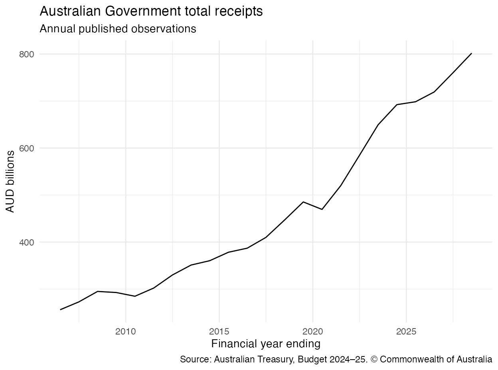

```{r setup, include=FALSE}
knitr::opts_chunk$set(
  collapse = TRUE,
  comment = "#>",
  error = FALSE,
  fig.width = 7,
  fig.height = 4
)
.readfiscalau_output_hook <- knitr::knit_hooks$get("output")
knitr::knit_hooks$set(output = function(x, options) {
  x <- gsub("[ \\t]+(?=\\n|$)", "", x, perl = TRUE)
  .readfiscalau_output_hook(x, options)
})
if (file.exists("DESCRIPTION") && requireNamespace("pkgload", quietly = TRUE)) {
  pkgload::load_all(".", quiet = TRUE)
}
library(readfiscalau)
source(file.path("vignettes", "_helpers.R"))
knitr::read_chunk(file.path("vignettes", "_chart-example.R"))
```

`readfiscalau` gives analysts and data engineers a versioned,
provenance-preserving workflow for selected Australian Commonwealth fiscal
publications. Use it to discover official release resources, read admitted
schemas, compare publication vintages, and preserve the exact source bytes
behind an analysis.

The package keeps publication-vintage, accounting-basis, observation-status,
source, licence, and parser metadata attached to observations. A normal read
uses an official HTTPS resource and a bounded, hash-addressed cache; an offline
read can replay exact raw bytes through the `raw` or `fetcher` arguments.

## Sources and coverage

`readfiscalau` brings together fiscal publications from three Australian
Government publishers:

| Publisher | Data in the package | Current admitted coverage |
|:--|:--|:--|
| [Australian Treasury](https://budget.gov.au/) | Budget and MYEFO publication-vintage tables, Final Budget Outcome (FBO) historical aggregates, and the Budget archive catalogue | 28 Budget vintages from 2000–01 to 2026–27; 25 MYEFO vintages from 2000–01 to 2025–26. The pinned FBO history contains annual actual aggregates from 1970–71 to 2024–25. The archive catalogue spans 1901–02 to 2026–27, with captured index evidence from 1926–27; it is discovery/preservation metadata, not chart-ready observations. |
| [Department of Finance](https://www.finance.gov.au/publications/commonwealth-monthly-financial-statements) | Commonwealth monthly financial statement aggregates and CKAN resource metadata | Archived monthly-statement PDFs begin in January 2000. The machine-readable aggregates used by the package begin in July 2000 and currently run through May 2026. Finance supplies July–May; a compatible Treasury FBO release can complete June. |
| [Parliamentary Budget Office](https://www.pbo.gov.au/publications-and-data/data-and-tools/data-portal/historical-fiscal-data) | Structured forecast workbooks used for selected Budget/MYEFO observations, plus a separate table-oriented Historical Fiscal Data reader | Historical-table coverage is table-specific: Table 9 AGS debt starts in 1900–01; Table 6 cash receipts in 1901–02; Table 8 cash flow in 1953–54; Table 7 expenses in 1964–65; Tables 1 and 2 aggregates in 1970–71; other tables start later. Budget/MYEFO forecast-panel coverage is described below. |

The ranges above describe data surfaced by this package release, not every
publication held by each agency. Coverage functions provide the exact range
for each admitted release, table family, series, and observation status.

### Finance monthly statements

Finance's official archive includes monthly-statement PDFs from
[January 2000](https://www.finance.gov.au/archive-link/australian-government-general-government-sector-monthly-financial-statements-january-2000).
The [machine-readable aggregates workbook](https://data.gov.au/data/en/dataset/australian-government-general-government-sector-monthly-financial-statements-tables-and-data/resource/1e1e039e-c54d-4c59-973b-7b15cde2ed63)
used by `readfiscalau` begins with fiscal year 2000–01, whose first observation
is July 2000. That is why `read_au_monthly_financial_history()` defaults to
`start_fiscal_year = "2000-01"` and returns dates beginning 31 July 2000 rather
than January 2000. The package does not parse the earlier 2000 PDFs.

The workbook supplies July–May year-to-date observations. The history reader
derives monthly flows while keeping stocks as month-end levels; Finance does
not publish a June monthly statement. A compatible FBO annual release can add
June, with any residual and revision risk flagged in the result. The workbook
contains cash measures such as receipts, payments, and cash balances alongside
accrual measures such as revenue, expenses, and balance-sheet items. It has a
material format and accounting boundary at 2008–09. `readfiscalau` retains
`accounting_basis`, `accounting_framework`, source labels, and `schema_family`;
it does not recast values across that boundary or imply that every series is
directly comparable through time.

### Budget and MYEFO publication-vintage data

The package has two complementary Budget/MYEFO contracts. The historical-table
snapshot is a static, installed RDS built from official Treasury PDFs. It covers
all 28 Budgets from 2000–01 to 2026–27 (including both 2022–23 Budgets) and all
25 MYEFOs from 2000–01 to 2025–26; no 2022–23 MYEFO was issued. It preserves
the actuals, estimates, forecasts, projections, table labels, page, URL, and
PDF SHA-256 printed in each publication. Reading it is offline and does not
reparse a PDF.

The snapshot follows 22 economically and fiscally material table families:

| Content | Table families in the installed snapshot | Earliest admitted publication |
|:--|:--|:--|
| Economic forecasts | Major economic parameters; international GDP growth; detailed domestic-economy forecasts | Major and domestic forecasts: Budget and MYEFO 2000–01. International GDP: MYEFO 2000–01 and Budget 2002–03. |
| Headline fiscal position | GGS Budget, balance-sheet and accrual aggregates; underlying-cash-balance reconciliation; underlying-to-headline bridge; fiscal-balance reconciliation | Headline Budget/MYEFO families begin between 2003–04 and 2004–05; balance-sheet, accrual and bridge layouts begin later. |
| Receipts and revenue | Detailed cash receipts; economic parameters for tax receipts; cash-receipts and accrual-revenue reconciliations | Detailed Budget receipts begin 2005–06 and MYEFO receipts 2006–07; reconciliation and parameter-table starts vary. |
| Expenses and investment | Expense-estimate reconciliation; expenses by function/sub-function; net-capital-investment reconciliation | Budget function tables begin 2000–01; other families begin from 2003–04. |
| Debt and interest | Forecast AGS on issue; net-debt components and reconciliation; cash and accrual interest | Most begin from 2013–14 to 2015–16; forecast AGS begins in 2020–21. |
| Formal statements | Operating statements, balance sheets and cash-flow statements for the four published government-sector scopes | MYEFO 2003–04 and Budget 2004–05. |

These dates describe the first matching table in the admitted PDFs, not the
first year in every series. A table can contain earlier actuals and later
forecasts, individual rows can start later, and some families have publication
gaps or presentation changes. `list_au_budget_myefo_families()` returns exact
Budget/MYEFO first and last vintages and release counts for all 22 families;
`list_au_budget_myefo_series()` returns each canonical series' source-cell
coverage. `list_au_budget_myefo_actual_histories()` returns one complete actual
history for each compatible series/unit/accounting path, while
`list_au_budget_myefo_series_profiles()` returns exact release-specific
forecast paths. Applications can replay either path directly with
`read_au_budget_myefo_actual_history()` or
`read_au_budget_myefo_series_profile()`; they do not assemble series from raw
publication cells.

Durable rows are queryable by one canonical `series_id`. For example,
underlying cash balance has one identity even when it appears in the aggregate,
reconciliation, bridge, and formal-statement tables. The default series reader
returns one preferred occurrence per release, period, unit, accounting basis,
and profile; `all_sources = TRUE` exposes every duplicate source occurrence.
The detailed domestic forecast table exposes all 23 durable rows in the 2026–27
Budget, and the detailed cash-receipts table exposes all 37 published
categories. Variable reconciliation detail remains available as a complete
table rather than being promoted into unstable series; the expense-estimate
reconciliation family is table-only. Aggregate `Total` columns and source
charts are not series.

```r
families <- list_au_budget_myefo_families()

ucb <- read_au_budget_myefo_series(
  "underlying-cash-balance",
  release = "treasury-budget-2026-27-final",
  unit = "AUD million"
)

domestic <- read_au_budget_myefo_table(
  "treasury-budget-2026-27-final",
  "domestic_economy_detailed_forecasts"
)
mining <- domestic[domestic$series_id == "mining-investment", ]
```

Table numbers change between releases, so the package uses stable family and
series IDs while retaining the exact `source_table`, `source_page`,
`source_url`, and `source_sha256`. See the
[historical Budget and MYEFO tables](vignettes/budget-myefo-table-history.Rmd)
article for the complete family map, query modes, deduplication rules, and
full-table workflow.

The older curated high-level panels remain available without behavior changes.
They cover five named families—Budget aggregates, major economic parameters,
domestic forecasts, cash receipts, and cash interest—across the same 28 Budget
and 25 MYEFO vintages. Their family-wide observation envelopes are 1998–99 to
2036–37 for Budget and 1998–99 to 2035–36 for MYEFO. Some normalized aggregate
and economic rows use the PBO's structured
[Historical budget forecasts and measures](https://www.pbo.gov.au/publications-and-data/data-and-tools/data-portal/historical-budget-forecasts-measures)
workbooks; their `observation_source_url` and
`observation_source_sha256` retain that distinction. Use
`list_au_budget_series()` / `list_au_myefo_series()` and
`read_au_budget()` / `read_au_myefo()` for this existing contract.
`read_au_budget_history()` remains the narrower cross-vintage reader for four
audited cash-receipts/accrual-revenue contracts.

## Status

The package is being prepared for CRAN. GitHub is the supported installation
source for users with access to the repository while that work is in progress;
the CRAN command below is intentionally aspirational until a release is
accepted. A private GitHub repository may require a GitHub login or personal
access token for `remotes::install_github()`. That installation access is
separate from the package's credential-free transport for official fiscal
source resources.

```{r install, eval=FALSE}
# Development version from GitHub
remotes::install_github("chartwell-macro/readfiscalau")

# Use only after an accepted CRAN release exists
install.packages("readfiscalau")
```

The public API is organized around source-specific discovery, coverage, typed
readers, history, and archive workflows. Each reader admits a documented
schema and fails closed when a source changes, keeping comparisons explicit and
reproducible.

## What can I do?

| Task | Start with | What it returns |
|:--|:--|:--|
| Browse known release vintages | `list_au_fiscal_releases()` | A local manifest of release/resource identities, dates, status, schemas, and source hashes |
| Populate an application search panel | `list_au_fiscal_search_controls()` | Small local `control`, `group`, `value`, and `label` metadata |
| Browse historical Budget/MYEFO tables | `list_au_budget_myefo_families()`, `list_au_budget_myefo_tables()` | Local coverage for 22 table families across 53 official publications, with page/URL/hash provenance |
| Query historical Budget/MYEFO rows | `list_au_budget_myefo_actual_histories()`, `read_au_budget_myefo_actual_history()`, `list_au_budget_myefo_series_profiles()`, `read_au_budget_myefo_series_profile()`, `read_au_budget_myefo_series()`, `read_au_budget_myefo_table()` | Package-constructed actual histories, exact release-specific forecast paths, raw canonical source cells, or complete published tables from the installed static snapshot |
| Inspect exact series coverage | `list_au_budget_series()`, `list_au_myefo_series()`, `list_au_pbo_historical_series()` | Local table/series coverage, dates, status, units, basis, and source identity |
| Read one release | `read_au_budget()`, `read_au_myefo()`, `read_au_fbo()`, `read_au_cfs()`, `read_au_monthly_financials()` | A `readfiscalau_data` tibble with observation and provenance fields |
| Compare Budget vintages | `read_au_budget_history()` | A `readfiscalau_history` tibble with resolved or all-vintage revision semantics |
| Read monthly fiscal history | `read_au_monthly_financial_history()` | A `readfiscalau_monthly_history` tibble in AUD million with derivation and coverage flags |
| Read PBO completed-year history | `read_au_pbo_historical()` | One selected table from the pinned PBO Historical Fiscal Data workbook |
| Preserve Budget documents | `crawl_au_budget_archive()`, `archive_au_budget_documents()` | An explicit, durable content-addressed archive with inventory and gap records |

Start with the coverage functions before reading. They show which release,
table family, series, actual/forecast status, dates, accounting basis, and
observation source the corresponding reader can return.

## Retrieve and chart a time series

The end-to-end path below selects the pinned Treasury Budget 2024–25 release,
validates its official Table 1 resource contract, filters the returned curated
data to `Total receipts`, and charts the annual values in AUD billions.

The manifest pins the selected resource hash, and the returned provenance
records both the Table 1 CSV and Budget Paper 1 Table 5.7 observation sources.
The source attribution is © Commonwealth of Australia; consult the
[Treasury terms](https://budget.gov.au/legal-notices.htm#h1) before reusing the
values. The visible code makes a bounded live request, so documentation builds
use the checked-in figure and remain deterministic and offline. Pass exact
bytes through `raw` or an injected `fetcher` for an offline replay.

```{r treasury-chart, eval=FALSE}
```



The returned `readfiscalau_data` object and its `readfiscalau_provenance`
attribute remain the reproducible source of record. The chart does not imply
Australian Government endorsement. The line includes both published actual
and forecast observations; retain `actual_forecast` from the full result when
that distinction matters.

## Compare historical Budget forecast vintages

The installed historical-table snapshot can also compare the path published
for one fiscal concept in different Budgets. The example below selects every
fourth Budget from 2004–05 through 2024–25, adds the latest 2026–27 Budget, and
plots the underlying cash balance from the GGS Budget aggregates as a share of
GDP. This consistent forecast unit is available in the admitted PDFs from
2004–05. The solid line adds the corresponding annual actuals from PBO
Historical Fiscal Data Table 1 over the same period; the dotted lines are the
selected Treasury Budget forecast paths.

Each dotted line is one publication vintage, not a subsequently revised actual
series. The forecast values, release IDs, table titles, pages, URLs, and PDF
hashes come from the bundled static RDS. The actuals come from the installed PBO
structured snapshot. The code is therefore deterministic and offline and does
not parse PDFs when it runs.

```{r budget-balance-vintages, fig.path="man/figures/", fig.width=7, fig.height=4.5, out.width="100%", fig.alt="A solid line shows annual underlying cash balance actuals while dotted lines compare forecast paths published in seven selected Australian Budgets from 2004–05 to 2026–27, all measured as a percentage of GDP."}
```

Use `all_sources = TRUE` when an audit needs every duplicate table occurrence;
the chart keeps the canonical GGS aggregate occurrence so each Budget-period
combination appears once.

## First success: an offline, real reader call

The first call below uses a small packaged chart-data-shaped CSV and a complete
fixture manifest row derived from the packaged Budget CSV schema contract. The
code replaces the release/resource identity with an explicitly synthetic
fixture record before calling the real Budget parser. It writes only to a
temporary cache, so it is deterministic and does not contact a live endpoint.
The numbers are fixture values for a schema/replay example, not a claim about a
current official release.

```{r first-success}
# This block is standalone after installing and loading readfiscalau.
library(readfiscalau)
fixture_path <- system.file(
  "extdata", "examples", "budget-current.csv", package = "readfiscalau"
)
stopifnot(nzchar(fixture_path), file.exists(fixture_path))
fixture_raw <- readBin(
  fixture_path, what = "raw", n = file.info(fixture_path)$size
)
fixture_release <- list_au_fiscal_releases(
  source = "treasury", release_type = "budget"
)
fixture_release <- fixture_release[
  fixture_release$schema_family == "treasury_chart_csv_v2", , drop = FALSE
][1, , drop = FALSE]
# Inherit the complete packaged 24-column contract, then identify the bytes as
# a synthetic fixture instead of claiming they are the selected release.
fixture_release[c(
  "release_id", "release_date", "period_end", "fiscal_year",
  "accounting_basis", "revision_semantics", "landing_url", "resource_id",
  "resource_role", "resource_url", "resource_updated_at", "expected_sha256"
)] <- list(
  "example-budget-2026-27", as.Date("2026-05-12"), as.Date("2027-06-30"),
  "2026-27", "mixed", "Small packaged chart-data-shaped example fixture.",
  "https://budget.gov.au/content/downloads.htm", "example-budget-chart-data",
  "example_chart_csv", "https://budget.gov.au/content/download/chart-data-final.csv",
  "2026-05-12T07:36:13Z", NA_character_
)
fixture <- read_au_budget(
  fixture_release,
  raw = fixture_raw,
  cache_dir = tempfile("readfiscalau-example-cache-")
)

fixture[, c(
  "series", "fiscal_year", "period_end", "value", "unit",
  "actual_forecast", "release_id"
)]
```

The result has class `readfiscalau_data`. Its provenance attribute carries the
exact raw-byte SHA-256 and cache snapshot path:

```{r first-success-provenance}
provenance <- attr(fixture, "readfiscalau_provenance")
c(
  release_id = provenance$release$release_id,
  source_url = provenance$source_url,
  raw_content_sha256 = provenance$raw_content_sha256,
  cache_hit = provenance$cache_hit,
  schema_version = provenance$schema_version
)
```

For a live read, choose a release ID from `list_au_fiscal_releases()` and omit
`raw`. The reader will fetch only the selected pinned HTTPS resource, validate
its declared media type and expected hash, and reuse a verified snapshot on a
later call:

```r
releases <- list_au_fiscal_releases(source = "treasury",
                                    release_type = "budget")
live <- read_au_budget(releases$release_id[[1]])
```

The live snippet is deliberately not run while building this README.

## Discover before you read

Discovery is a separate, metadata-first step. The following packaged HTML
snapshot demonstrates the candidate shape without network access:

```{r discovery}
treasury_candidates <- discover_au_fiscal_releases(
  source = "treasury",
  raw = example_raw("treasury-downloads.html")
)
treasury_candidates[, c(
  "release_type", "title", "fiscal_year", "resource_url",
  "discovery_status"
)]
```

The Department of Finance CKAN helper retains historical resource metadata
rather than silently keeping only the newest file:

```{r ckan-discovery}
finance_resources <- discover_finance_ckan_resources(
  raw = example_raw("finance-ckan.json")
)
finance_resources[, c(
  "resource_id", "name", "format", "created", "last_modified",
  "resource_url"
)]
```

Use `list_au_fiscal_releases()` and the series-coverage functions to select a
curated, supported manifest row after discovery. A link being discoverable does
not make arbitrary PDF, DOCX, spreadsheet, HTML, appropriation-table, or
financial-statement-note content parseable.

## Common workflows

### Budget vintages and revisions

`read_au_budget_history()` is for one canonical series across compatible
Budget vintages. `observation = "actual"` and `observation = "forecast"` are
selected separately. The default `vintages = "resolved"` applies the latest
compatible official vintage per period; `vintages = "all"` retains revisions
for review.

```r
budget_history <- read_au_budget_history(
  release = "treasury-budget-2026-27-final",
  table_id = "Table 1",
  series = "Total receipts",
  observation = "actual",
  vintages = "resolved"
)
```

### Monthly Finance history

`read_au_monthly_financial_history()` derives monthly flows from Finance YTD
observations while leaving stock aggregates as month-end levels. Finance monthly
statements cover July–May; June is an annual FBO/CFS boundary. When comparable,
June flow is the FBO annual actual less May YTD and is flagged because the
residual can include revisions to earlier months.

```r
monthly_history <- read_au_monthly_financial_history(
  start_fiscal_year = "2020-21",
  end_fiscal_year = "2024-25",
  output = "monthly"
)
```

### PBO historical tables

The PBO reader is table-oriented. Browse local coverage first, then select by
canonical table ID, published `"Table N"`, or table number:

```r
pbo_tables <- list_au_pbo_historical_tables()
pbo_table <- read_au_pbo_historical(table_id = "Table 6")
```

The admitted PBO history ends at 2024–25. Later estimates and projections are
intentionally handled through Budget/MYEFO release-vintage APIs.

### Budget document preservation

The bundled archive catalogue is safe to inspect without network access:

```r
catalogue <- read_au_budget_archive_catalogue()
head(list_au_budget_archive_candidates(
  budget_vintage = "2025-26",
  availability = "available"
))
```

`crawl_au_budget_archive()` captures official index pages but does not download
candidate documents. `archive_au_budget_documents()` is the explicit admission
step: it streams one file at a time into a durable append-only archive, stores
hashes and terms, and records failures as gaps. Plan disk capacity before a
large run and use `validate_au_budget_archive()` to check the ledger. An
archived document is not automatically a parsed data contract.

## Output and provenance contract

Single-release readers return a `readfiscalau_data` tibble. Common observation
columns include `table_id`, `series_id`, `series`, `fiscal_year`, `period_end`,
`value`, `unit`, `unit_multiplier`, `accounting_basis`, `consolidation`,
`actual_forecast`, and `profile_type`. Release metadata columns include the
release ID/type/status/date, source and resource URLs, resource update time,
schema/parser version, terms, `vintage_date`, `retrieved_at`, and
`raw_content_sha256`. Family-specific columns remain explicit; inspect the
reference page for the exact contract of the reader you use.

`attr(x, "readfiscalau_provenance")` records the selected release, source and
final URL, retrieval time, raw snapshot path/bytes, HTTP and response-size
metadata, SHA-256, cache-hit state, cache namespace, parser/contract/schema
revisions, dependency versions, and source terms. ZIP reads also identify the
selected archive member.

The historical readers preserve their own contracts. Budget history has
`readfiscalau_history_provenance`, while monthly history has
`readfiscalau_monthly_history_provenance` with output mode, source provenances,
coverage, derivation rules, June completion, and the accounting-boundary note.
Do not discard these attributes when exporting a result for reproducibility.

The historical Budget/MYEFO table readers return ordinary tibbles backed by
the installed static snapshot. Their row-level provenance columns include the
exact publication table/page, official URL, parsed-PDF SHA-256, downloadable
container SHA-256, ordered archive members where relevant, and an assembly
flag. They do not create a user cache or attach retrieval-time metadata because
no runtime retrieval occurs.

### Release terms versus observation sources

There are two provenance layers for curated Budget and MYEFO panels. The
release-level columns `license`, `terms_url`, and `attribution` describe the
selected release/resource row; `resource_url` and `raw_content_sha256` identify
the bytes used to satisfy that release contract. The coverage functions also
report `observation_source_url` and `observation_source_sha256` for each
release/table-family/series/status row. For parsed curated-vintage reads, the
same observation-source pairs are retained in
`attr(x, "readfiscalau_provenance")$archive_member$observation_sources`.

Do not infer observation-level reuse rights from the release-level licence.
Some Budget and MYEFO observations are derived from separate PBO products even
though they are returned under a Treasury Budget or MYEFO release identity:

| Observation product | Observation source recorded in the panel | Terms to apply |
|:--|:--|:--|
| Treasury Budget/MYEFO publication tables | The selected Treasury Budget/MYEFO resource | Treasury legal notice and the release-level terms |
| PBO structured Budget forecasts and measures | [PBO Historical budget forecasts and measures (2026–27 Budget)](https://www.pbo.gov.au/sites/default/files/2026-05/2026-27%20Budget%20-%20Historical%20budget%20forecasts%20and%20measures.xlsx) | PBO copyright notice and CC BY-NC-ND 4.0 caveat |
| PBO structured MYEFO comparator/forecast measures | [PBO Historical budget forecasts and measures (2025–26 MYEFO)](https://www.pbo.gov.au/sites/default/files/2026-03/PBO%20Historical%20budget%20forecasts%20and%20measures%20-%202025-26%20MYEFO.xlsx) | PBO copyright notice and CC BY-NC-ND 4.0 caveat |

Treasury release terms do not license PBO-derived observations. For any row
whose `observation_source_url` is a PBO product, retain the observation hash
and apply the [PBO copyright notice](https://www.pbo.gov.au/copyright-information),
which records the PBO Creative Commons Attribution-NonCommercial-NoDerivatives
4.0 International terms and publisher exceptions. See `inst/TERMS.md` for the
source-level notices and do not imply that a Treasury release licenses a PBO
workbook or its derived observations.

## Network, cache, and offline behavior

- The built-in transport is credential-free and HTTPS-only. It has explicit
  timeout/retry/byte limits and rejects partial responses, content-length
  mismatches, unsafe redirects, media-type mismatches, and changed pinned
  bytes.
- The default cache is `readfiscalau_default_cache()`, a platform user-cache
  directory. It is bounded by `readfiscalau_cache_prune()` and may be replaced
  with an explicit `cache_dir`.
- `raw` exact bytes and an injected `fetcher` are intended for offline replay
  and tests. The package does not download data at install or load time.
- The durable Budget archive is separate from the bounded source cache. Its
  default is `readfiscalau_default_archive_dir()` (or the
  `READFISCALAU_BUDGET_ARCHIVE_DIR` environment variable), and the package does
  not silently prune it.

## Scope and limitations

The package supports named schema families and curated release contracts. It
does not promise to parse every official fiscal publication. In particular:

- The historical Budget/MYEFO snapshot covers 22 selected table families in
  the admitted 2000–01 onward publications, not every table in each document.
  Individual family and series ranges vary; earlier archive documents are
  discoverable but are not part of this parsed snapshot.
- There was no 2022–23 MYEFO publication because the October 2022–23 Budget
  supplied that mid-year update.
- The PBO historical workbook is admitted through 2024–25 only.
- Finance monthly releases cover July–May. June remains FBO/CFS; published
  blanks remain `NA`, and accounting-framework changes are not recast.
- The package does not generally parse arbitrary PDF/DOCX/workbook/HTML
  content, appropriation tables, or financial-statement notes.
- Budget archive preservation stores exact bytes, hashes, terms, replacements,
  and explicit gaps. It does not turn an archived document into chart-ready
  data or expand its licence.
- The installed exact Budget index captures include inline third-party
  analytics loader code as well as Treasury material. The package records this
  boundary but does not claim a whole-file redistribution licence for those
  composite pages; consult `inst/TERMS.md` before reusing them.

## Troubleshooting

| Condition or symptom | What to check |
|:--|:--|
| `release_type` | Use the typed reader matching the manifest row (`read_au_budget()`, `read_au_myefo()`, etc.). |
| `table_required` for a ZIP | Supply the exact `table_id` for the desired CSV member. |
| `source_hash`, `truncated`, `http`, `unsupported_media`, or `too_large` | Inspect the selected resource URL/status and expected hash; do not coerce a changed response. Retry later or choose another admitted manifest row. |
| `schema` or `duplicate_observation` | The source shape, units, periods, or labels changed; use a supported resource and report the source drift. |
| `june_is_annual` | Use an FBO or CFS release for June; Finance monthly statements are July–May. |
| `history_contract` or `history_series` | Choose a supported canonical table/series from the coverage functions. |
| `table_family`, `table_required`, or `series_not_found` | Use the Budget/MYEFO family, table, and series catalogues to select an exact installed identifier and available release combination. |
| Archive capacity/lock/gap result | Inspect `list_au_budget_archive()` and `validate_au_budget_archive()`; check free space and resume deliberately. |
| Repeated downloads | Reuse the same `cache_dir`; inspect `readfiscalau_provenance$cache_hit` and prune only with `readfiscalau_cache_prune()`. |

## Terms, citation, and contribution

Every curated result carries release-level `terms_url`, `license`, and
`attribution`; Budget/MYEFO coverage also identifies the observation-level
source URL and hash. Read the installed source-terms file `inst/TERMS.md` and
the terms for each exact source resource before redistributing data. Treasury,
Finance, and PBO resources have different source-level terms and publisher exceptions;
retaining a source byte does not expand its licence or imply endorsement.

Cite the package version or commit together with the official release/resource
URL and vintage used for an analysis. The package repository is at
<https://github.com/chartwell-macro/readfiscalau>; report reproducible bugs and source
drift at <mailto:chartwellmacro@gmail.com>. See
the repository's `CONTRIBUTING.md` for the contribution workflow: new source
rows should include verified HTTPS,
hash/terms metadata, a small replay fixture, contract tests, and documentation.

`readfiscalau` is authored and maintained by **Chartwell Macro**. The repository's
`inst/CITATION` and `CITATION.cff` contain machine-readable citation metadata.
Package-authored code is released under the MIT terms in `LICENSE`, with Chartwell Macro
as its copyright holder. This does not relicense bundled government data,
captured official pages, logos, or other source material; the applicable
publisher terms remain recorded in `inst/TERMS.md` and `inst/COPYRIGHTS`.

Further reading:

- [Getting started](https://chartwell-macro.github.io/readfiscalau/articles/readfiscalau.html)
- [Release catalogues and discovery](https://chartwell-macro.github.io/readfiscalau/articles/release-catalogues.html)
- [Provenance and cache](https://chartwell-macro.github.io/readfiscalau/articles/provenance-and-cache.html)
- [Budget archive operations](https://chartwell-macro.github.io/readfiscalau/articles/budget-archive.html)
- [Troubleshooting](https://chartwell-macro.github.io/readfiscalau/articles/troubleshooting.html)
- [Package reference](https://chartwell-macro.github.io/readfiscalau/reference/)
